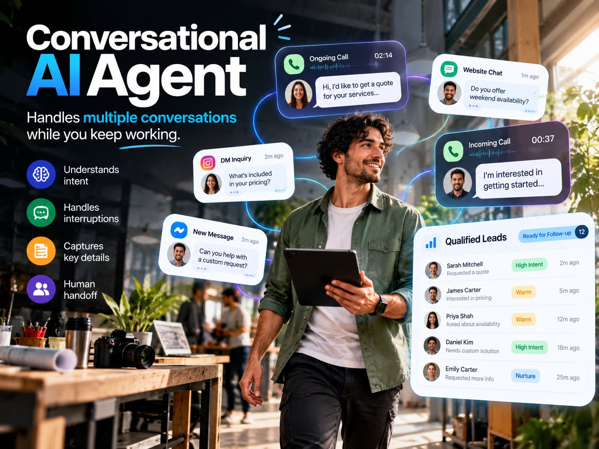
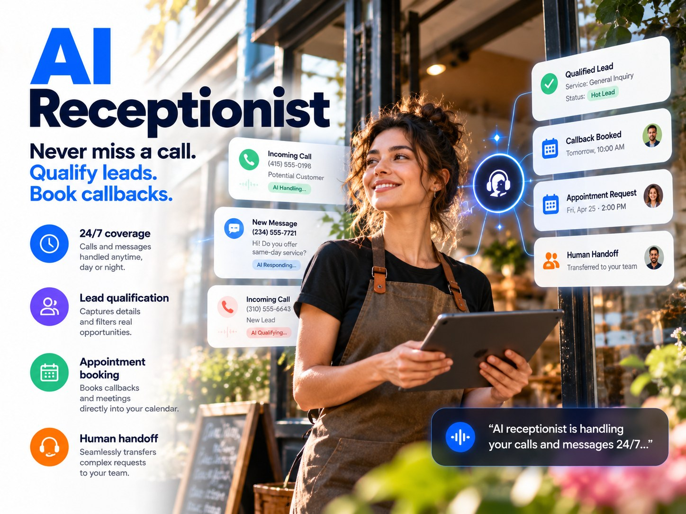
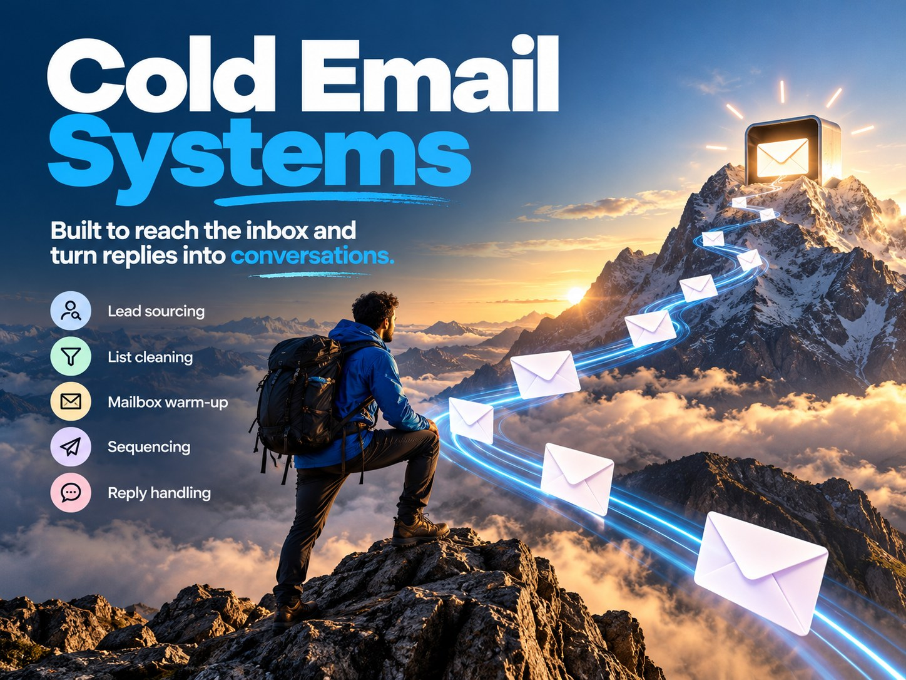
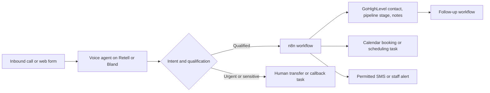

# AI Voice Agents and Automation Systems for Service Businesses

I build AI voice agents and automation systems that answer calls, qualify leads, book appointments, update CRMs, and trigger follow-ups. My services also include service-business website development and B2B outbound infrastructure.

**Stack:** Retell AI, Bland AI, Synthflow, GoHighLevel, n8n, Twilio, Supabase, Next.js, Smartlead, InboxKit

**Try the voice agent:** [Interactive Retell preview](https://agent.retellai.com/preview/agent_ed761677e80ef1b36cf0a5b94e) (browser call, no phone number needed)

## Projects

| Project | Business problem | What I built | Evidence in this repo |
|---|---|---|---|
| [Bail-bonds intake receptionist](projects/bail-bonds-intake.md) | Urgent calls arrive after hours or while staff are busy | Voice agent that collects intake details, respects knowledge limits and escalates to a licensed agent | Qualification design, test scenarios, anonymized prospect response |
| [Retell AI conversational agent](projects/retell-conversational-agent.md) | Scripted bots fail when callers interrupt, change topic or give partial answers | Adaptive conversation design with branching, interruption handling and handoff rules | Live preview link, routing diagram, evaluator tests |
| [GoHighLevel speed-to-lead automation](projects/speed-to-lead-crm.md) | New leads go cold while nobody responds | Form or missed-call trigger to AI callback or SMS, discovery questions, CRM write, booking or callback task | Workflow specification, acceptance checklist, architecture diagram |
| [Service-business websites and lead capture](projects/service-business-websites.md) | Visitors cannot find the phone number or the form goes nowhere | Responsive sites with click-to-call, lead forms and integration-ready submissions | Scope and acceptance checklist, anonymized enquiry example |
| [B2B outbound outreach systems](projects/outbound-email-systems.md) | Cold email bounces, lands in spam or gets no replies | Prospect sourcing, verification, sending infrastructure, sequences and reply handling | Workflow, tooling, anonymized reply and campaign dashboard |

## Services at a glance

Concept graphics with fictional sample data; each links to its project page.

| | |
|---|---|
|  |  |
|  |  |
|  | |

## How a typical system fits together

Each box is a component I design, configure and test. Which boxes are live in a given project depends on the client's platforms, consent rules and budget, and the project pages say which parts are implemented and which are proposed.

## What a connected agent should handle

1. **Answer calls:** take incoming and after-hours calls, identify the enquiry, answer approved business questions, escalate urgent or sensitive requests to a person.
2. **Qualify prospects:** ask what service is needed, where, when and how urgently, adapting questions to the answers received.
3. **Book appointments:** check calendar availability where integrated, and distinguish a confirmed booking from sending a scheduling link.
4. **Update CRM records:** create or update contacts, notes, opportunities, tags and pipeline stages without creating duplicates.
5. **Follow up:** trigger permitted SMS messages, reminders, staff alerts or callback tasks.
6. **Handle exceptions:** interruptions, background noise, unanswered questions, human handoffs, webhook failures and calendar errors.

## Speed to lead

Speed to lead is the time between a new enquiry and the first meaningful response. A **30-second initial response is a design target**, not a measured benchmark or a guarantee. Actual speed depends on provider latency, automation rules and testing.

## Voice-agent design considerations

Prompts and business knowledge; branching and follow-up questions; interruption sensitivity and natural turn-taking; response pacing; background-noise handling; calm phrasing under stress; unsupported-answer boundaries; transfer and callback rules. The linked Retell preview is a way to **try the conversation**, not proof that every setting or integration is active.

## Tools and integration boundaries

- **Voice:** Retell AI and Bland AI (built and tested). Synthflow (used to generate and configure receptionist agents; no separate shipped build documented in this repo yet). Vapi and GoHighLevel Voice AI (familiar, no shipped build in this repo).
- **CRM and workflows:** GoHighLevel, n8n, REST APIs and webhooks, Supabase, contact records and lead-routing logic.
- **Telephony and messaging:** Twilio, A2P 10DLC registration, consent capture, STOP handling, delivery monitoring.
- **Possible integrations, scoped per project:** Cal.com, Calendly, Google Calendar, HubSpot, Zoho, Frappe CRM, Notion, Slack, Jotform, Jobber, Housecall Pro, ServiceTitan.
- **U.S. texting:** A2P 10DLC registration is required for business texting on long codes. Registration by itself does not grant permission to message; documented consent and opt-out handling are still needed.

## Evidence and privacy

These are **demonstrations, design samples and technical documentation**. The images in `assets/` are either recreated and anonymized illustrations based on real outreach and demonstrations, or concept graphics with fictional sample data (marked as such); they are not pixel-exact screenshots, verified testimonials or performance reports. Example scenarios use fictional information. Credentials, client records, personal contact details and direct phone-demo numbers are excluded. Work enquiries and pre-contract communications stay on Upwork where required.
