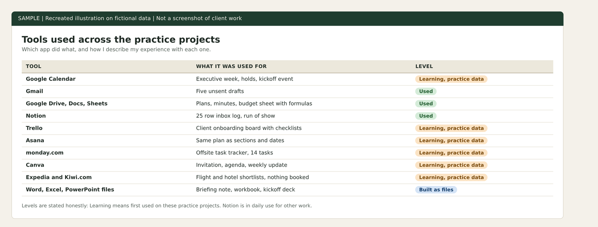

# How I work as a remote assistant

This page sets out the rules I follow, so a client can see the method before the first task. It describes how I intend to work. The projects in this repository are practice work on invented data, and [this note](CONFIDENTIALITY.md) explains why.

## Three rules for anything that leaves the building
1. I draft. You send. Emails, invitations and messages wait in drafts until you say yes.
2. I shortlist. You choose. Travel, venues and suppliers come as three options with the trade offs written down, and nothing is booked or paid without your yes.
3. I ask once. If I am blocked I ask one clear question with a recommended answer. If I am not blocked I choose the sensible reading and tell you which one I took.

## Time zones
I work from Harare (UTC+2). Every time I write down is shown in both your zone and mine, and I check clock change dates before I confirm a meeting. New York and London change clocks on different weekends, so a call that is 5 hours apart most of the year can be 4 hours apart for one week.

## What I do when something goes wrong
| Situation | What I do |
| --- | --- |
| Double booking | Name both, propose a fix, wait for your choice |
| A deadline is at risk | Tell you the day I see it, with the options |
| An email needs a decision I cannot make | Put it at the top of your morning brief with a draft reply |
| I made a mistake | Say so, fix it, and say what I changed |
| A request looks odd or unsafe | Pause and check with you before acting |

## Privacy
- I ask for shared access to what a task needs and nothing more. I never ask for passwords.
- I do not keep client material after a task ends unless asked to, and I do not reuse it anywhere else, including in a portfolio.
- Anything I show publicly is rebuilt on invented data.

## A weekly rhythm that works
- Monday: week plan and conflicts list
- Daily: morning brief, inbox sorted into five groups
- Friday: one page weekly update, open actions with owners and dates

## Handover template
Use this when a task changes hands or pauses.

```
Task:
Status (done, in progress, blocked):
What is finished:
What is next, with the date:
Waiting on (person and date):
Files and links:
Decisions still needed from you:
```

## Tools and how I describe my experience
| Tool | Level |
| --- | --- |
| Notion | Daily use |
| Google Drive, Google Sheets, Gmail drafts | Used |
| Google Calendar, Trello, Asana, monday.com, Canva, flight and hotel search | Learning, used on practice data |
| Word, Excel and PowerPoint files | Built as files for the samples |

I am at the start of my freelance work and have no paid assistant history to claim. What I can show is the method, the documents and a willingness to be tested on a small first task.


Which app did what, with the level stated for each.
