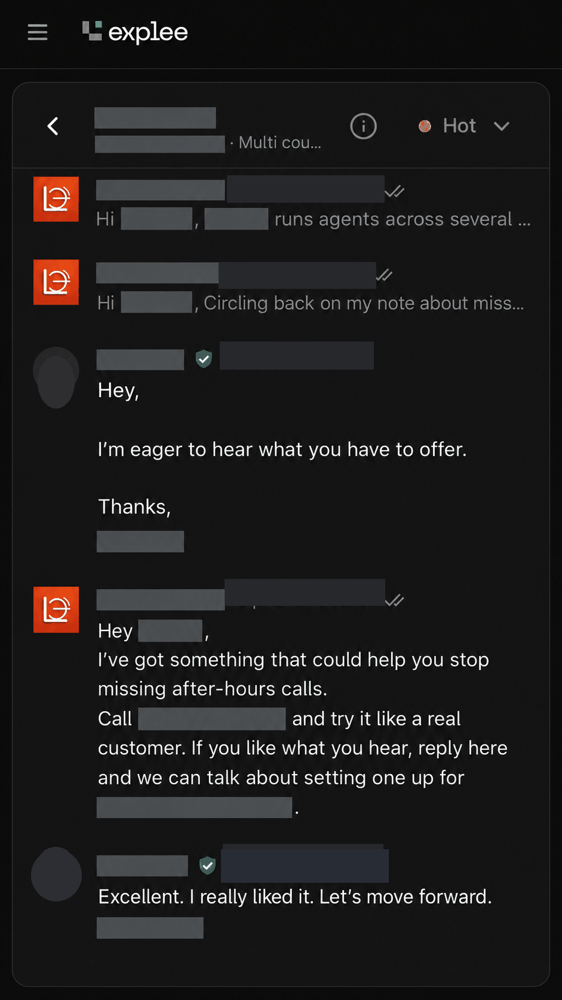

# U.S. Bail-Bonds AI Intake Receptionist

**Type:** conversational voice-agent demonstration for U.S. bail-bond agencies.
**Status:** built and tested as a demonstration on Retell AI; no production deployment for a paying client is claimed.

## Business problem

Urgent bail enquiries arrive after hours or while staff are busy. A missed call is often a lost client, because the family calls the next agency on the list. An AI receptionist can collect the minimum useful intake information and route the caller to a qualified person without giving legal advice or promising an outcome.

## What I built

- A Retell AI agent with a bail-specific system prompt, knowledge boundaries and escalation rules.
- A qualification path that collects, in order: whether the enquiry concerns the caller or someone else, where the arrest happened and which jail or county is involved if known, callback details, and urgency.
- Guardrails so the agent explains that case-specific bond questions need a licensed team member rather than guessing.
- Transfer, staff-notification and callback behaviour defined for urgent calls.
- Scenario-based test calls (fictional details only) covering incomplete information, out-of-area arrests and requests for a human.

## How it works

1. Caller reaches the agent's number (or the browser preview).
2. Agent greets, identifies whether the call is a bail enquiry, a general question or something else.
3. For bail enquiries it asks one question at a time, confirming the answers back.
4. If the enquiry is urgent or outside the agent's knowledge, it offers a transfer or a callback and records the request.
5. Collected fields are available to a webhook or n8n workflow for CRM writes and staff alerts. In this demonstration the CRM write is designed and tested with fictional data; it is not connected to a client's live CRM.

## Try fictional scenarios

- "My brother was arrested last night. I don't know what jail he's at. What do you need from me?"
- "I'm calling about someone arrested in another county. Can your agency help?"
- "I need to speak to a licensed bail agent. Can you arrange a callback?"

Do not supply real arrested-person details in a test. The publicly callable demonstration number is intentionally not included in this repository; the [Retell browser preview](https://agent.retellai.com/preview/agent_ed761677e80ef1b36cf0a5b94e) shows the same conversation design.

## Evidence

*Recreated and anonymized illustration.* An agency prospect was invited to call the demonstration agent and try it like a real customer. The prospect replied positively and asked to proceed to a conversation about setting one up. Names, business identity, phone number, dates and other identifiers have been removed. This shows prospect interest in the demonstration; it does not show a signed contract, a live deployment or measured call outcomes.

## Implemented versus possible

| Implemented and tested | Possible with client access |
|---|---|
| Conversation prompts, qualification path, escalation rules, knowledge boundaries | Live transfer to the agency's on-call phone |
| Fictional-data test calls | CRM writes into the agency's GoHighLevel or other CRM |
| Browser preview and phone demonstration | SMS confirmation to the caller (A2P 10DLC and consent required) |
| Webhook payload design for intake fields | After-hours routing rules tied to the agency's schedule |
