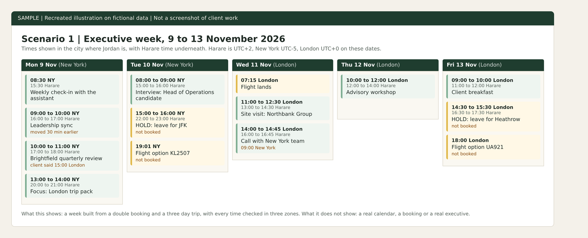
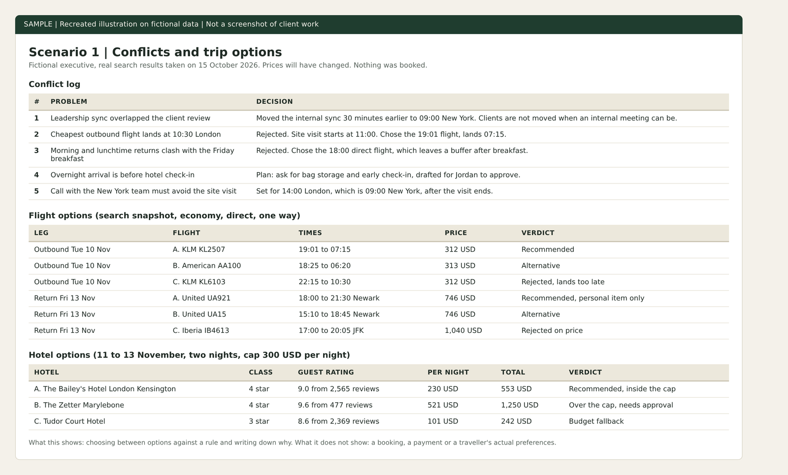

# Executive week and London trip

Practice project on fictional data. Cedarline Partners, Jordan Hale and every other company and person named here are made up. This is not paid client work and not full-time executive assistant experience. Nothing was booked, sent or paid. The image is a recreated illustration, not a screenshot of a client system.

Why made-up data: real client work is confidential, so I rebuilt this kind of task on invented names and figures. See [why these projects use made-up data](../CONFIDENTIALITY.md).

## The assignment
Jordan Hale, a made-up Managing Director in New York, has a busy week from Monday 9 November 2026 and a three day trip to London. The job: build a clean calendar, fix the conflicts, shortlist flights and hotels, and leave one page to read.

## What I did
- Built the week as SAMPLE calendar events with no attendees and no notifications.
- Checked every time in New York, London and Harare. On these dates New York is UTC-5, London UTC+0, Harare UTC+2.
- Logged five conflicts and the decision on each.
- Searched flights and hotels and shortlisted three of each against a written travel rule (hotel cap 300 USD per night, no pod hotels).

## Decisions worth reading
- A leadership sync overlapped a client review. The internal meeting moved, not the client.
- The cheapest outbound flight lands at 10:30 London and the site visit starts at 11:00. Rejected, and I took the 19:01 flight that lands at 07:15.
- Morning and lunchtime returns clash with the Friday breakfast. I took the 18:00 direct flight.
- Between 25 October and 1 November London is only four hours ahead of New York, because the clocks change a week apart. Any meeting set in that week needs a second look.

## Implemented and tested
Calendar events created and checked in three time zones. Flight and hotel search run on 15 October 2026. Prices will have changed.

## Possible with client access, not done
Booking, adding confirmations to the calendar, flight status checks the evening before each leg, and a trip pack sent to the traveller.

## Tools and honest levels
Google Calendar, Expedia search, Kiwi.com search: learning, used here for the first time on practice data. Google Drive: used.

Recreated illustration of the sample calendar. Fictional data.

Recreated illustration of the decision tables. Search prices are a snapshot and nothing was booked.
