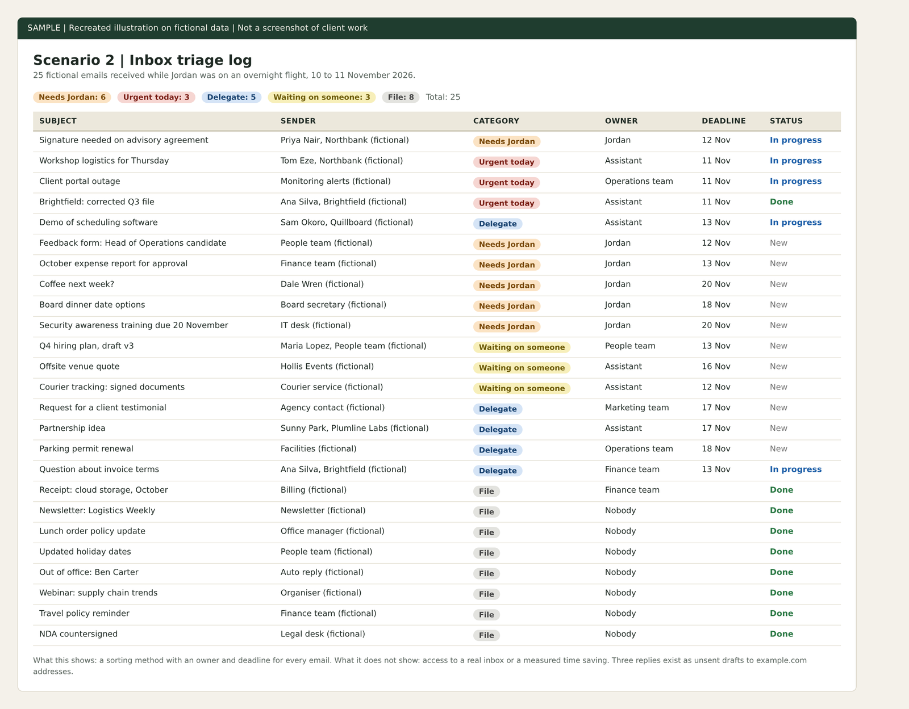
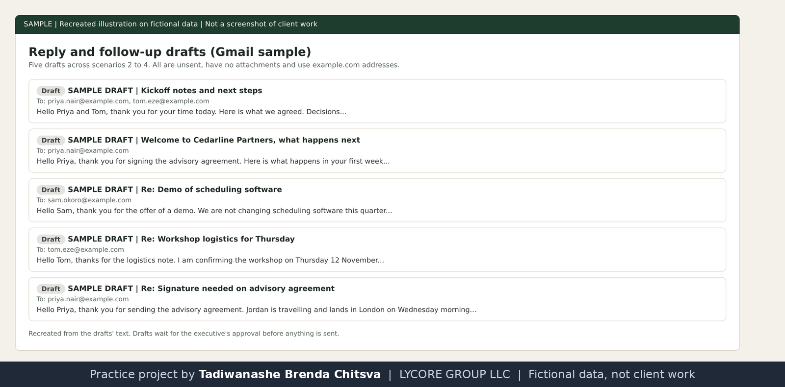

# Inbox triage and morning brief

Practice project on fictional data. Cedarline Partners, Jordan Hale and every other company and person named here are made up. This is not paid client work and not full-time executive assistant experience. Nothing was booked, sent or paid. The image is a recreated illustration, not a screenshot of a client system.

Why made-up data: real client work is confidential, so I rebuilt this kind of task on invented names and figures. See [why these projects use made-up data](../CONFIDENTIALITY.md).

## The assignment
Twenty five fictional emails arrive while Jordan is on an overnight flight. Sort them, handle what can be handled, draft replies, and leave a brief that takes two minutes to read.

## What I did
- Wrote five triage rules: urgent today, needs Jordan, delegate, waiting on someone, file.
- Logged all 25 emails in a Notion database with sender, category, owner, deadline, next step and status. The count came to 3 urgent, 6 needing Jordan, 5 to delegate, 3 waiting and 8 to file.
- Wrote three reply drafts as unsent Gmail drafts to example.com addresses.
- Wrote the morning brief: what needs Jordan, what is already in hand, one piece of good news, and what is on today.

## Rules I worked under
- Routine replies that only confirm logistics or decline a sales approach could be sent by the assistant.
- Anything that commits Jordan to a date, a signature, money or an opinion waits for a yes.
- Passwords and payment details are never handled in email.
These are assumptions for the sample. In real work they would be agreed with the executive first.

## Implemented and tested
The Notion log, the three drafts and the brief, all on fictional data.

## Possible with client access, not done
Reading a real inbox, applying labels, forwarding to the right team and learning the executive's own preferences.

## What I would ask first
Before doing this for a real executive I would ask:
1. Which senders always reach you, whatever the hour?
2. What may I answer myself, and what always waits for your yes?
3. When do you read the morning brief, and how long should it be?
I would write the answers down once and work from them, so I do not ask the same question twice.

## Tools and honest levels
Notion: daily use. Gmail drafts and Google Drive: used.

Recreated illustration of the Notion log. Fictional data, no real senders.

Recreated illustration of the five unsent drafts across the practice projects. Every address uses example.com.
