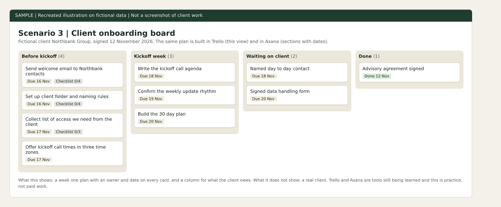
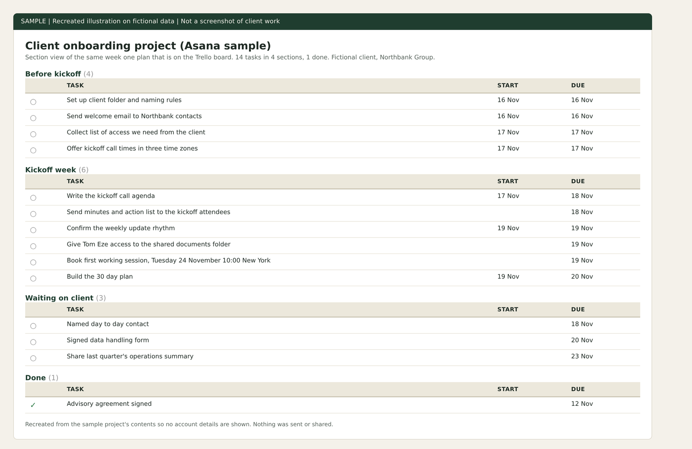

# Client onboarding board

Practice project on fictional data. Cedarline Partners, Jordan Hale and every other company and person named here are made up. This is not paid client work and not full-time executive assistant experience. Nothing was booked, sent or paid. The image is a recreated illustration, not a screenshot of a client system.

Why made-up data: real client work is confidential, so I rebuilt this kind of task on invented names and figures. See [why these projects use made-up data](../CONFIDENTIALITY.md).

## The assignment
Cedarline signs a made-up client, Northbank Group, on 12 November 2026. Get the client ready for a kickoff call on 18 November: a plan, a folder, a welcome message, and a list of what the client owes.

## What I did
- Built the plan in Trello as a board with four lists and a checklist on each card that has several steps.
- Built the same plan in Asana as sections with start and due dates, so both styles are on show. In real work only one would be used.
- Wrote the access list. It asks for shared documents only and never for passwords.
- Wrote the welcome email as an unsent draft. Jordan approves it before it goes.

## Decisions worth reading
- A separate column for what the client owes, with a chase date, so waiting items do not hide.
- The kickoff time is checked in New York, London and Harare before it goes out.

## Implemented and tested
The Trello board, the Asana project, the checklists and the draft.

## Possible with client access, not done
Sending the welcome email, sharing the folder, chasing the client and updating the board as items land.

## Tools and honest levels
Trello and Asana: learning, used here for the first time on practice data. Gmail drafts and Google Drive: used.

Recreated illustration of the Trello board. Fictional client.

Recreated illustration of the Asana project, the same plan in section and date form. Fictional client.
