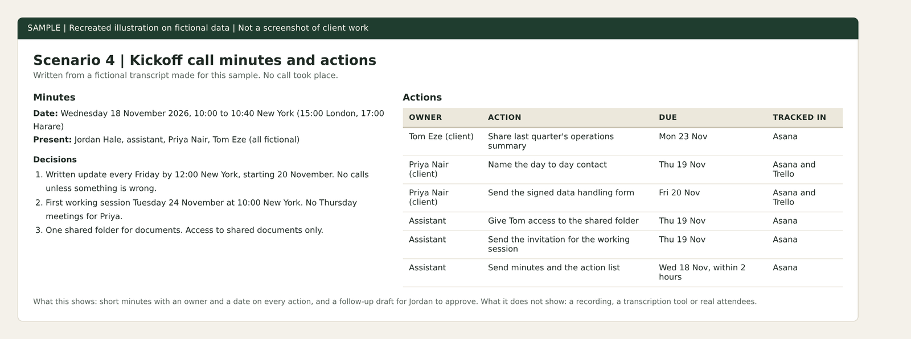

# Meeting prep, minutes and action items

Practice project on fictional data. Cedarline Partners, Jordan Hale and every other company and person named here are made up. This is not paid client work and not full-time executive assistant experience. Nothing was booked, sent or paid. The image is a recreated illustration, not a screenshot of a client system.

Why made-up data: real client work is confidential, so I rebuilt this kind of task on invented names and figures. See [why these projects use made-up data](../CONFIDENTIALITY.md).

## The assignment
Prepare Jordan for the Northbank kickoff call on 18 November 2026 at 10:00 New York (15:00 London, 17:00 Harare), write the minutes, turn decisions into tracked actions, and draft the follow-up.

## What I did
- Wrote a one page briefing note and a 45 minute agenda.
- Set up the calendar event with a meeting link and nobody invited.
- Wrote a short fictional transcript for the sample, then wrote the minutes from it. Only what was said goes in the minutes.
- Added the four new actions to the Asana project with owners and dates. The two client actions already on the board were not duplicated.
- Wrote the follow-up email as an unsent draft.

## Implemented and tested
The briefing note, agenda, calendar event, minutes, Asana tasks and draft.

## Possible with client access, not done
Joining a real call, using a recording or a transcription tool, and sending the follow-up. No call took place. Zoom and Otter style tools have not been used.

## Tools and honest levels
Google Calendar and Asana: learning, used here for the first time on practice data. Google Drive and Gmail drafts: used.

Recreated illustration of the minutes. Written from a fictional transcript.
