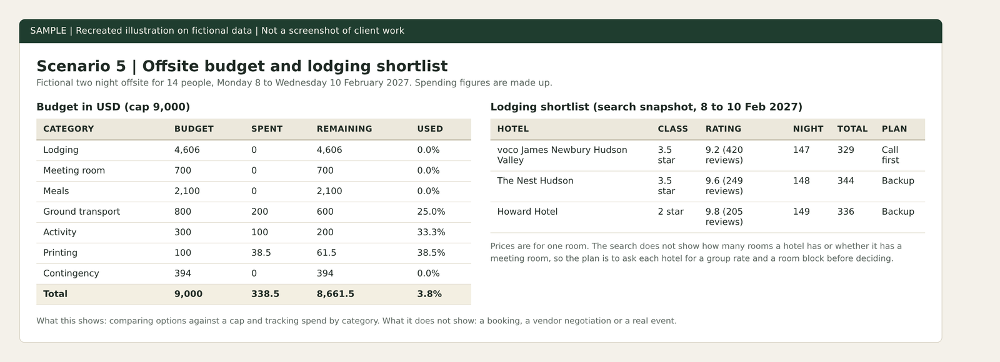
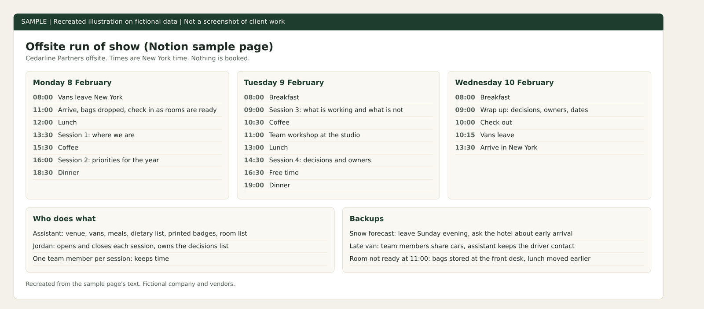

# Team offsite budget and lodging shortlist

Practice project on fictional data. Cedarline Partners, Jordan Hale and every other company and person named here are made up. This is not paid client work and not full-time executive assistant experience. Nothing was booked, sent or paid. The image is a recreated illustration, not a screenshot of a client system.

Why made-up data: real client work is confidential, so I rebuilt this kind of task on invented names and figures. See [why these projects use made-up data](../CONFIDENTIALITY.md).

## The assignment
Plan a two night offsite for 14 people, Monday 8 to Wednesday 10 February 2027 in the Hudson Valley, with a budget cap of 9,000 USD.

## What I did
- Searched lodging and shortlisted three hotels against a target of 175 USD per room per night.
- Built a budget sheet where a new line in the expense log updates the totals by category. The spending in it is made up.
- Wrote a run of show in Notion, with a backup for snow, a late van and a room that is not ready.
- Started an invitation design in Canva. It is a sample and was not sent.

## Decisions worth reading
- The search shows single room prices only. It does not show how many rooms a hotel has or whether it has a meeting room. The plan is to ask each hotel for a group rate and a room block before choosing, so capacity is not assumed.
- Contingency is 394 USD, about 4 percent, which is thin. The plan flags that and asks whether to trim meals.
- A snow delay would cost one extra night, about 2,300 USD, which is more than the contingency. That needs the executive's decision.

## Implemented and tested
The shortlist, the budget sheet with formulas, the run of show.

## Possible with client access, not done
Asking hotels for quotes, booking, collecting dietary needs and tracking real spend.

## What I would ask first
Before doing this for a real executive I would ask:
1. Is the cap a total or per person, and what is flexible: dates, place or headcount?
2. Who signs off a booking before any deposit is paid?
3. What must the venue have, and what would you swap for a lower price?
I would write the answers down once and work from them, so I do not ask the same question twice.

## Tools and honest levels
Google Sheets: used. Notion: daily use. Expedia search and Canva: learning.

Recreated illustration of the budget sheet. Spending figures are made up.

Recreated illustration of the Notion run of show page. Fictional company and vendors.

Recreated illustration of the monday.com task board for the same offsite.
