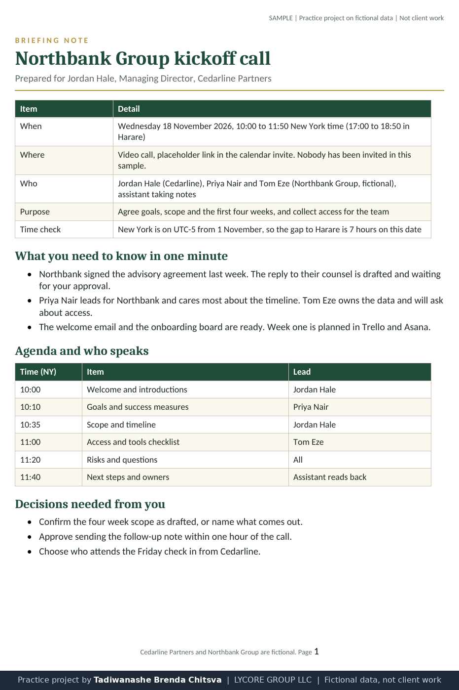
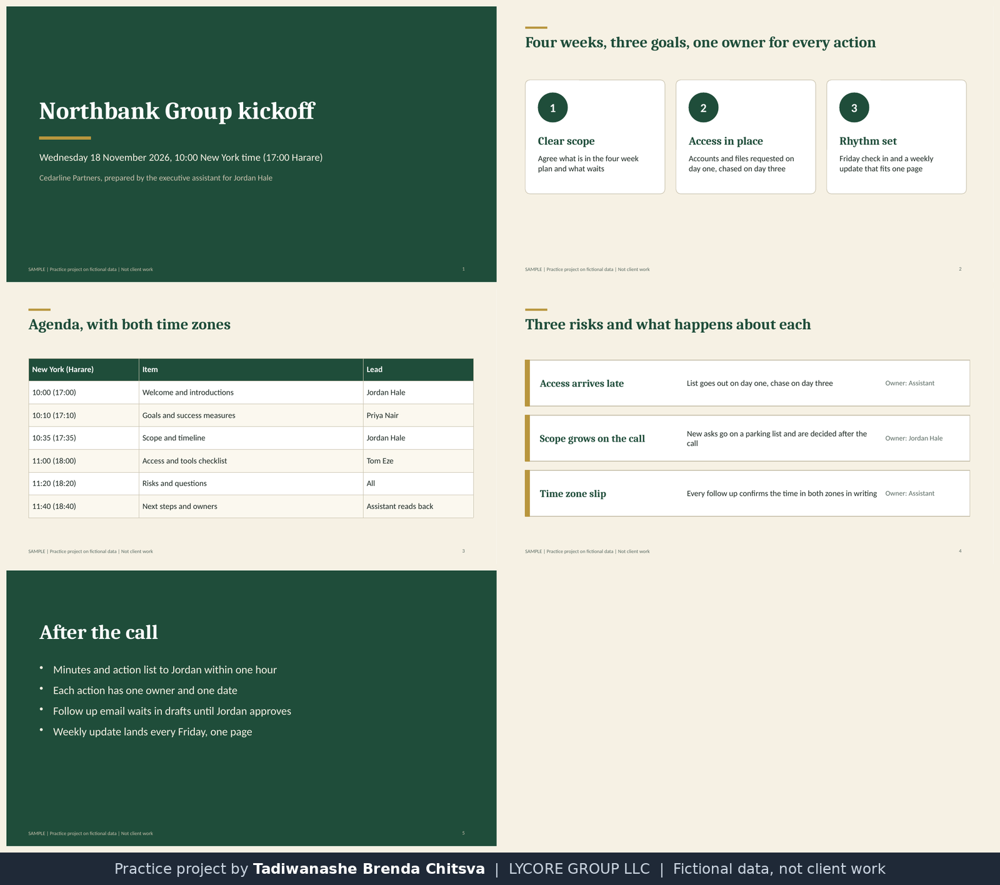
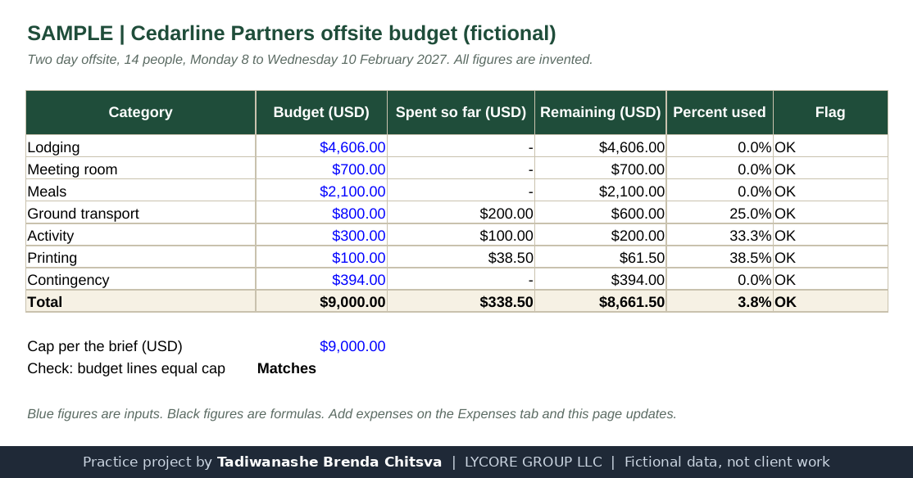
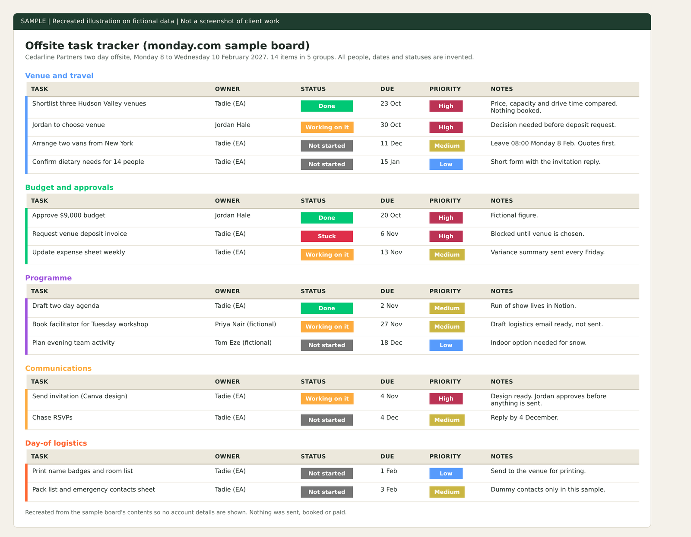
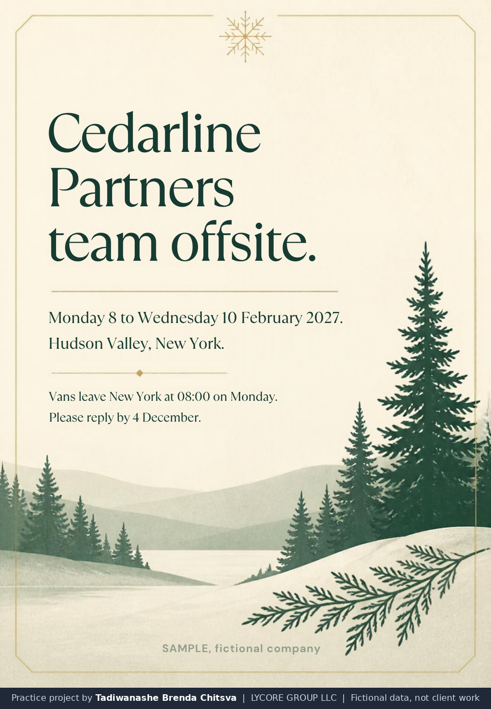
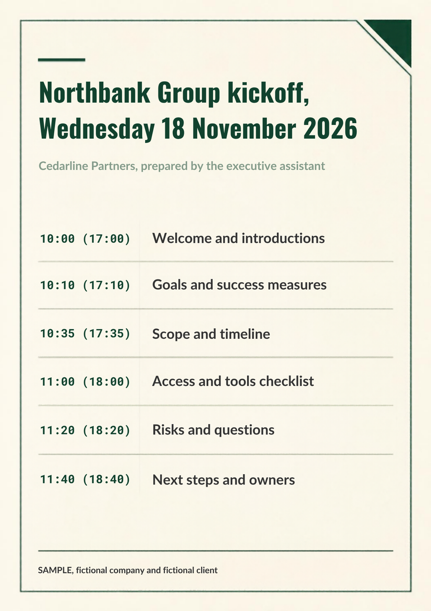
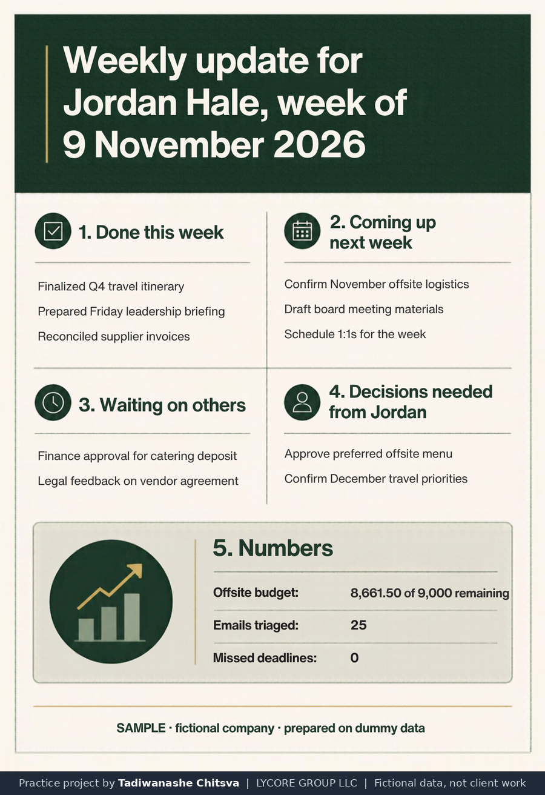

# Documents, slides, spreadsheets and designs

Practice project on fictional data. Cedarline Partners, Northbank Group and every person named here are made up. This is not paid client work and not full-time executive assistant experience. Nothing was sent, booked or paid. Images are rendered from the sample files themselves, with no account details visible.

Why made-up data: real client work is confidential, so I rebuilt this kind of task on invented names and figures. See [why these projects use made-up data](../CONFIDENTIALITY.md).

## The assignment
An executive needs the paperwork around the other five projects to be ready to use: a briefing note for the kickoff call, a deck to open it, a budget workbook for the offsite, an invitation, a one page agenda and a weekly update template. Each one has to be clear on a phone screen, checked, and honest about what is made up.

## What I did
- Wrote a two page briefing note in Word format: who, when, what to know in one minute, agenda with speakers, decisions needed, risks.
- Built a five slide kickoff deck in PowerPoint format with a theme, two layouts, speaker notes and both time zones on the agenda.
- Built a budget workbook in Excel format: a budget tab, an expense log tab and a read me tab. Spend per category is calculated from the log, so adding a row updates the totals. The total of 9,000 USD is checked against the cap.
- Designed an offsite invitation, a one page kickoff agenda and a weekly update one pager in Canva.
- Set up a monday.com board for the offsite: five groups, 14 tasks, an owner, status, due date and priority on each.

## Decisions worth reading
- Every file carries a SAMPLE line, so nothing can be mistaken for a real document.
- The workbook marks inputs in blue and formulas in black, and has a flag column that turns amber at 80 percent of a line and red over budget.
- The agenda shows New York time with Harare time in brackets, because a mixed time zone meeting fails on the time, not the content.
- The invitation asks for a reply by a date and states when the vans leave, since those are the two questions guests always ask.

## Implemented and tested
The three files open and render. The workbook has 34 formulas and no errors after a full recalculation, and the totals match the Google Sheet from the offsite project (spent 338.50, remaining 8,661.50, 3.8 percent). The monday.com board and the three Canva designs exist and were read back.

## Possible with client access, not done
Sending the invitation, sharing the board with a team, linking the board to a client's own tools and keeping the weekly update going week after week.

## What I would ask first
Before doing this for a real executive I would ask:
1. Are there brand rules: logo, colours, fonts?
2. Who approves a document or design before it leaves, and in what format do you want it, editable or PDF?
3. Which files already exist that I should reuse, not rebuild?
I would write the answers down once and work from them, so I do not ask the same question twice.

## Tools and honest levels
Word, Excel and PowerPoint files: built as files here, not inside the Microsoft 365 apps. Canva and monday.com: learning, used for the first time on practice data. Google Sheets: used. Notion: daily use.

Rendered from the sample Word file.

Rendered from the sample PowerPoint file.

Rendered from the sample Excel file. Figures are invented.

Recreated illustration from the sample board's contents.

Canva design on a fictional company.

Canva design on a fictional company and client.

Canva design. The numbers match the budget workbook.

The editable files are in the [samples](../samples) folder.
