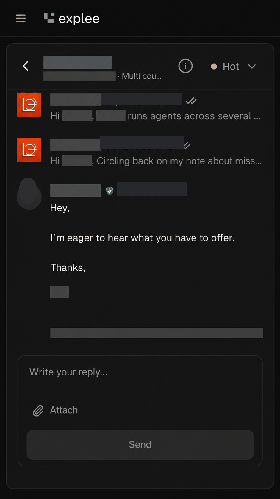
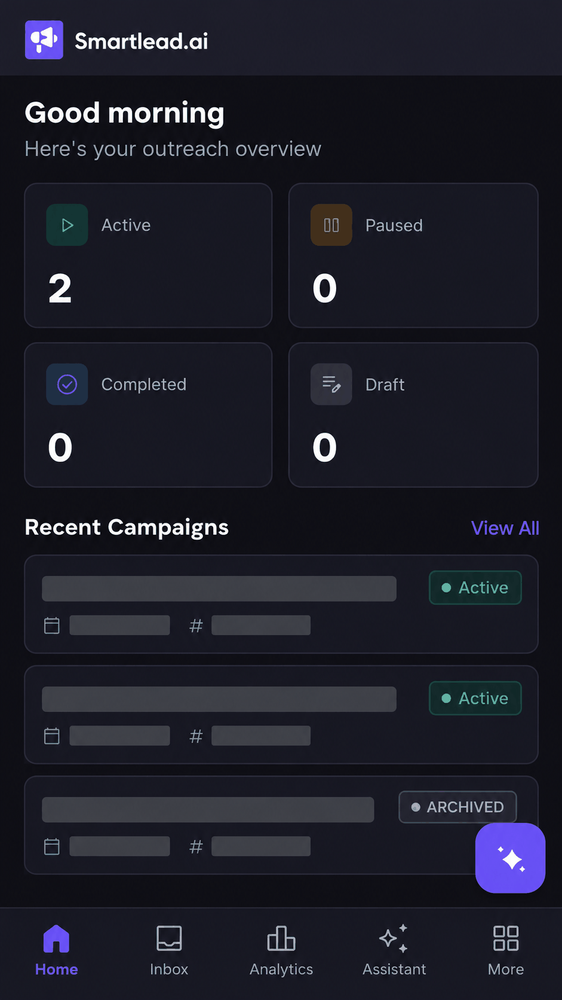

# B2B Outbound Prospecting, Cold Email and Deliverability Systems

**Type:** outbound operations, lead-list quality and campaign infrastructure for U.S. B2B service-business prospecting.
**Status:** built and run for LYCORE's own outreach on Smartlead, InboxKit and Explee; results are described as engagement, not revenue.

## Business problem

Cold email fails for predictable reasons: unverified lists that bounce, sending from the main business domain, no warm-up, generic copy and nobody handling the replies. Each of those is an infrastructure or process decision, and each one is fixable.

## What I built

1. **Ideal customer profile definitions** by business type, geography, role and exclusion criteria.
2. **Decision-maker sourcing** using Hunter.io and GetLeads.io, with manual relevance checks.
3. **Verification and cleaning**: email validation, deduplication and suppression of unsuitable contacts.
4. **Sending infrastructure**: separate outreach domains and mailboxes purchased and configured through InboxKit, kept apart from the primary business domain; SPF, DKIM and DMARC checked; warm-up and ramp-up schedules set before volume.
5. **Sequences** in Smartlead and Explee: concise, specific messages personalized around observable business problems, with a short follow-up.
6. **Reply handling**: interested contacts routed to a sales conversation, opt-outs honoured, bounces and errors tracked, outcomes logged.
7. **Review**: mailbox health, replies and positive responses measured rather than send volume alone.

## Evidence

*Recreated and anonymized illustration.* A prospect replied to a two-step sequence about missed calls, saying they were eager to hear the offer. Names, company, email addresses and dates have been removed. This documents prospect engagement following personalized outreach; it does not prove a sale, a contract or a measured campaign conversion rate.

*Recreated and anonymized illustration.* The Smartlead overview shows two active campaigns and one archived, which is how I organize outreach by vertical and keep retired sequences out of the active set. Campaign names, dates and identifiers have been removed. It does not support claims about delivery rates, meetings booked or pipeline revenue.

## Experience and tool familiarity

**Hands-on in LYCORE outreach work:** Smartlead, InboxKit, Explee, Hunter.io, GetLeads.io, domain registrars and DNS configuration, mailbox warm-up, personalization and sales discovery.

**Known or evaluated:** PlusVibe, Instantly, Email Bison, MillionVerifier, NeverBounce and Bouncer. These show platform familiarity and should not be read as a claim of production experience with every platform.

**Development and planning tools:** Claude, Claude Code, ChatGPT and OpenAI Codex as supporting environments. They are tools, not evidence that they independently designed or shipped a project.

## Quality and compliance

- Maintain suppression and opt-out handling and applicable anti-spam compliance.
- Do not send unsolicited messages to unverifiable or unrelated contacts.
- Verify both contact identity and email deliverability where appropriate.
- Protect prospect information; never upload client lists or credentials to public repositories.
- Validate sending limits and infrastructure before increasing campaign volumes.
- Do not claim guaranteed inbox placement or invented reply or booked-meeting rates.

## Sample deliverables

Prospect-data checklist, verification workflow, sending-infrastructure checklist, outreach sequence structure and reporting fields for replies and booked meetings.

## Implemented versus possible

| Implemented and run | Possible for a client |
|---|---|
| Domain and mailbox setup, warm-up, DNS authentication | Same setup under the client's own registrar and sequencer accounts |
| Smartlead and Explee campaigns with reply routing | CRM integration so positive replies create deals automatically |
| List sourcing and verification process | Ongoing list refresh and A/B testing of copy under agreed volumes |
