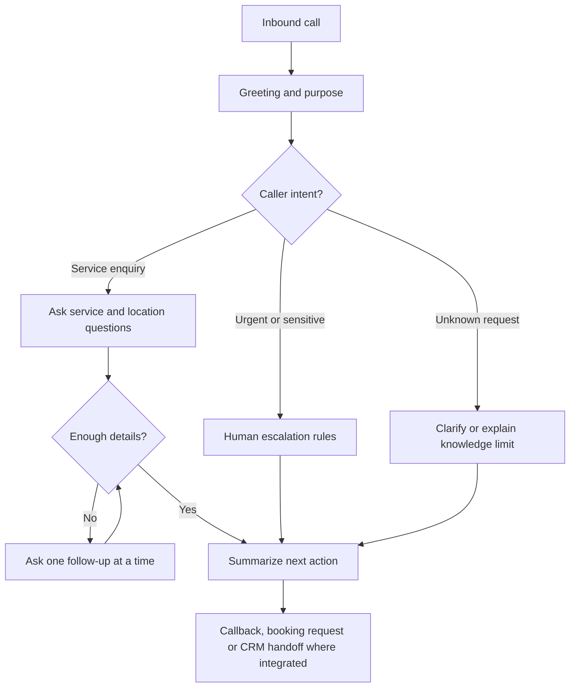

# Retell AI Conversational Voice Agent

**[Try the interactive Retell preview](https://agent.retellai.com/preview/agent_ed761677e80ef1b36cf0a5b94e)**

**Goal:** A conversational agent that recognizes the caller's intent, asks useful follow-up questions and adapts its responses instead of reading an inflexible script.

## Conversation engineering

- **Interruptions / barge-in:** assess whether a caller can stop the agent mid-sentence and whether it resumes with the right context.
- **Turn-taking and latency:** tune when the agent speaks versus waits for the caller.
- **Noise and silence:** test televisions, traffic, background speakers and pauses.
- **Pacing and acknowledgements:** avoid robotic monologues and excessive fillers.
- **Empathetic responses:** use appropriate calm wording in stressful enquiries, with human escalation for high-stakes matters.
- **Branching and qualification:** change questions according to intent, service area, urgency and missing information.
- **Guardrails:** say when information is unknown rather than guessing or promising outcomes.
- **Handoffs:** define transfer, callback or internal-notification behavior.

These are **design and test topics**, not a claim that every setting is active in the shared preview.

## Suggested evaluator tests

1. Interrupt during an answer and ask a new question.
2. Give incomplete or ambiguous information.
3. Change the service you are asking about halfway through.
4. Ask for a human representative or a callback.
5. Ask an unrelated or out-of-knowledge question.

## Business integrations

Voice-agent outcomes can be routed via webhooks or n8n to GoHighLevel contacts and pipelines, CRM notes, calendars (Cal.com, Calendly, Google Calendar) or Slack/Notion notifications where configured and supported. Do not describe an integration as completed until it has been tested.

**Evidence to add:** screenshots of the editor with secrets removed, anonymized test transcripts, and successful sample webhook/CRM updates.

## Illustrative conversation routing

This diagram illustrates design reasoning. The publicly shared preview does not by itself verify every transition or integration.
