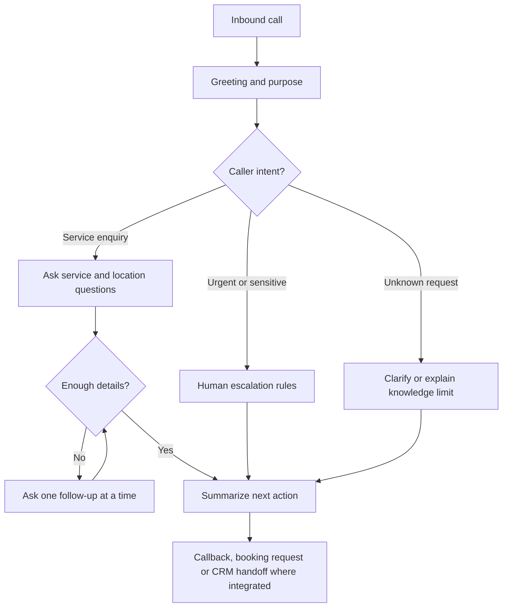

# Retell AI Conversational Voice Agent

**[Try the interactive Retell preview](https://agent.retellai.com/preview/agent_ed761677e80ef1b36cf0a5b94e)**

**Goal:** a conversational agent that recognizes the caller's intent, asks useful follow-up questions and adapts its responses instead of reading an inflexible script.
**Status:** built and tested on Retell AI; the preview is live. Business integrations below are described as designs unless marked tested.

## Business problem

Scripted phone bots fail the moment a caller interrupts, changes topic or gives half an answer. Service businesses need an agent that behaves like a competent receptionist: listens, confirms, asks the next useful question and knows when to hand off.

## What I built

- A Retell agent with a structured system prompt: role, business knowledge, allowed answers, forbidden answers, escalation triggers.
- Intent recognition at the start of the call with separate paths for service enquiries, urgent or sensitive matters and unknown requests.
- Branching qualification that changes questions according to intent, service area, urgency and missing information.
- Interruption, turn-taking, silence and noise settings tuned through repeated test calls.
- Handoff behaviour: transfer, callback or internal notification depending on the trigger.

## Conversation engineering

- **Interruptions and barge-in:** confirm a caller can stop the agent mid-sentence and that it resumes with the right context.
- **Turn-taking and latency:** tune when the agent speaks versus waits for the caller.
- **Noise and silence:** test televisions, traffic, background speakers and long pauses.
- **Pacing and acknowledgements:** avoid robotic monologues and excessive fillers.
- **Empathetic responses:** calm wording in stressful enquiries, with human escalation for high-stakes matters.
- **Branching and qualification:** change questions according to intent, service area, urgency and missing information.
- **Guardrails:** say when information is unknown rather than guessing or promising outcomes.
- **Handoffs:** define transfer, callback or internal-notification behaviour.

These are design and test topics, not a claim that every setting is active in the shared preview.

## Suggested evaluator tests

1. Interrupt during an answer and ask a new question.
2. Give incomplete or ambiguous information.
3. Change the service you are asking about halfway through.
4. Ask for a human representative or a callback.
5. Ask an unrelated or out-of-knowledge question.

## Business integrations

Voice-agent outcomes can be routed via webhooks or n8n to GoHighLevel contacts and pipelines, CRM notes, calendars (Cal.com, Calendly, Google Calendar) or Slack and Notion notifications where configured and supported. An integration is only described as completed once it has been tested.

## Illustrative conversation routing

This diagram illustrates design reasoning. The publicly shared preview does not by itself verify every transition or integration.

## Implemented versus possible

| Implemented and tested | Possible with client access |
|---|---|
| Retell agent, prompt structure, intent paths, qualification branching | Calendar availability checks and confirmed bookings |
| Interruption, pacing and noise tuning via test calls | CRM writes into the client's GoHighLevel, HubSpot or other CRM |
| Browser preview | Live transfer to staff numbers and after-hours routing |

**Evidence to add on request:** editor screenshots with secrets removed, anonymized test transcripts and sample webhook payloads.
