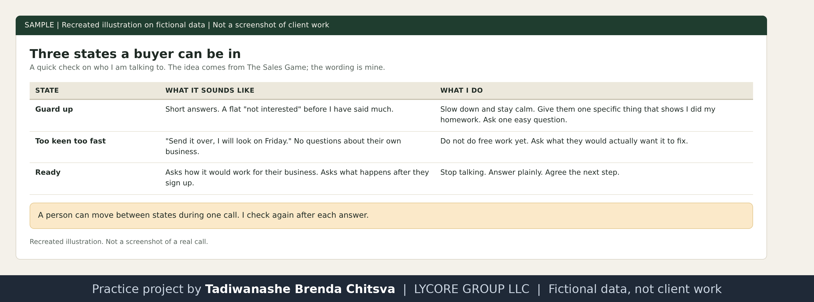

# Mindset and posture before I dial

Method page. This describes how I run cold calls, in my own words. It is not a results report: I have not closed a paying client yet, and nothing here claims a booked deal or a conversion rate. Any business or person named is made up. See [why these projects use made-up data](../CONFIDENTIALITY.md).

## What I tell myself before I dial
I tell myself I am a helper. I am here to help the next person. I never look at myself as someone disturbing them or a nuisance, because the second I assume that, my attitude on the call changes. Being helpful becomes harder when I have already told myself that I am a disturbance and should not be there.

## I do not use one rule for everyone
I pace how I speak based on the person I am talking to: their tonality, and how they want to be presented. I never use a rule that applies to all. I align myself with the client, their situation and who they are.

## Why this matters from the other side of the phone
The person who picks up cannot see my notes. They hear my assumption in my tone. If I expect to be an interruption, I start to sound like one: the voice gets softer, the first sentence turns into an apology, and the owner hears someone who does not think the call is worth their time. If I expect to be useful, the same words land as a person with a reason to call. The mindset is not decoration. It changes the first five seconds, and those five seconds decide whether the call is a conversation or a hang up.

## Reading the state the person is in
The Sales Game describes three states a buyer can be in at a given moment, and says a person can move between them during one call. I use this as a quick check on who I am talking to, in my own words:

| State | What it sounds like | What I do |
| --- | --- | --- |
| Guard up | Short answers, a flat "not interested" before I have said much | Slow down, stay calm, give them something specific that shows I did my homework, ask one easy question |
| Too keen too fast | "Send it over, I will look on Friday" with no questions about their own business | Do not do free work yet. Ask what they would actually want it to fix |
| Ready | Asks how it would work for their business, asks what happens after they sign up | Stop talking, answer plainly, agree the next step |

Recreated illustration. Not a screenshot of a real call.

## Ideas from the books that support this (my summary, not quotes)
- The Sales Game treats confidence as something the other person picks up on before they weigh the words. Belief in what you offer travels down the line, and so does doubt.
- The Complete Sales Workbook suggests simple ways to take rejection less personally: assume the person had a hard day, remember they are turning down a phone call and not you, and keep a tally so each no counts as a step.
- Both books say the same plain thing in different language: prepare the person you will be on the call, not just the words.

## Honest level
This is how I work and how I prepare. I have placed cold calls to US service businesses in pest control, towing, bail bonds and water restoration. I have no conversion figures to show, and I do not post recordings or real business names.
