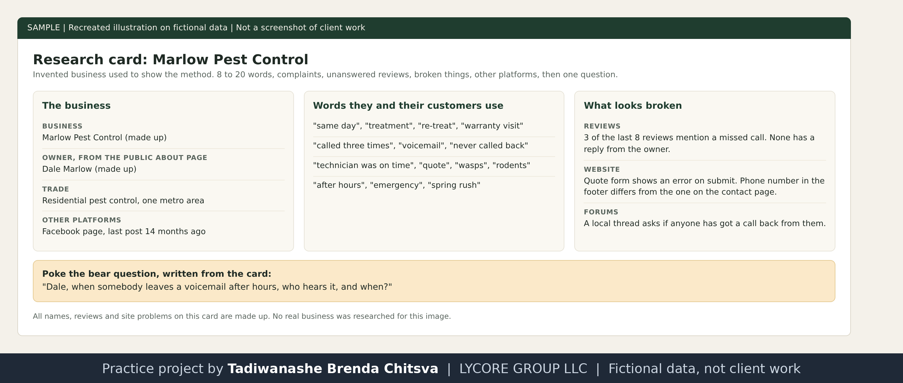

# Research before the call

Method page on a made-up business. Marlow Pest Control and Dale Marlow do not exist, and no real business was researched for this page. This is a method, not a results report. See [why these projects use made-up data](../CONFIDENTIALITY.md).

## Why I research first
Business owners today get a lot of cold pitches. My estimate is somewhere between 30 and 100 a month, from small agencies and consultants selling automation and voice agents. They are tired of it, and that is the truth of the situation. To get out of that crowd I have to stand out and give value, and I have to make the owner see that I am not another interruption.

So before I call, I do my own background check on the business. I look for the small things that do not add up, that need fixing, that are broken. I lead with those, because they are real problems that already exist and the owner cannot ignore them. Then I ask what they are doing about those issues.

## What I collect
I look for 8 to 20 words that the owner and their customers actually use, plus:
- complaints, in reviews, forums and Reddit threads for that trade
- the business's own site and what it says about itself
- reviews the owner has not replied to
- broken things on the website, such as a form that fails or a phone number that does not match
- any other platform the business uses

That collection is my arsenal and my rapport when I call. I also write one poke the bear question out of it: a question about something real that is already uncomfortable, asked plainly.

## Worked example on a made-up business

Recreated illustration on invented data. No real business, review or website.

What the card turns into on the call:
- The opener names what customers say, not where I found it. See [openers and gatekeepers](sales-03-openers-and-gatekeepers.md).
- The poke the bear question is about the missed calls, because three of the last eight reviews are about them and the owner has not answered any.
- The broken contact form is saved for later in the call as a free fix. See [value first for busy owners](sales-06-value-first-and-busy-owners.md).

## Why specific research works on the person hearing it
- A real problem cannot be waved off the way a pitch can. The owner already knows it is there, so I am not asking them to believe a claim.
- Specific details show that this call was made for them. A general line fits thirty businesses, and the owner can tell.
- It changes what the call is about. The owner stops deciding whether I am a nuisance and starts deciding what to do about the problem.
- A generic opening puts me on top of the pile of pitches they already ignore, and then every later sentence is heard as part of that pile.

## Rules I keep
- Public business information only. No private accounts, no personal data about the owner beyond their public business role.
- I never invent a problem to make a call sound urgent. If the research does not find a real problem, I do not call that business yet.
- I do not paste real findings into this repository. Real research belongs to the lead.
