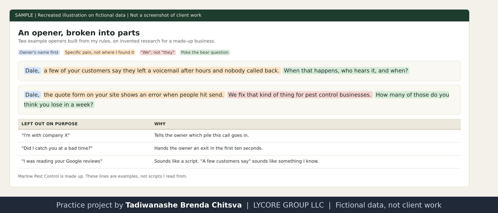

# Openers and gatekeepers

Method page. The business, the owner and the examples are made up for this page. The rules are mine. This is not a results report. See [why these projects use made-up data](../CONFIDENTIALITY.md).

## My rules for an opener
1. **Name first.** I start with the owner's real name, found in my research, so the first thing they hear is their own name.
2. **No company name up front.** An opener that starts with "I'm with company X" is burned. The owner has heard it dozens of times and stops listening at the company name.
3. **Name the specific pain.** I say what customers are saying, not where I found it. "A few of your customers say they left a voicemail and nobody called back" sounds like something I know. "I was reading your Google reviews" sounds like a script.
4. **Say we, not they.** When I describe what we do, I say we. I do not create distance between me and the work.
5. **Test it with a poke the bear question.** Something real and a little uncomfortable, asked plainly, about the problem I found.

## Gatekeepers
I open as if the owner picked up. I use the owner's researched name and the specific thing I am calling about, in the tone of an ordinary call. I do not ask permission to speak to anyone, I do not negotiate, and I do not accept the first no. A receptionist's no is a routine filter. It is not a decision the owner made.

## Example on a made-up business

Recreated illustration. Marlow Pest Control is made up.

The two lines in the picture are examples built from my rules on invented research. They are not scripts I read from.

## What I avoid and why
The reasons are on the page [lines I avoid and why](sales-07-lines-i-avoid-and-why.md). In short, each line I avoid either hands the owner an easy exit in the first ten seconds, or tells them I am one more pitch.

## Honest level
Openers and gatekeeper handling are how I call. I have placed cold calls to US service businesses. I have no conversion numbers to show.
