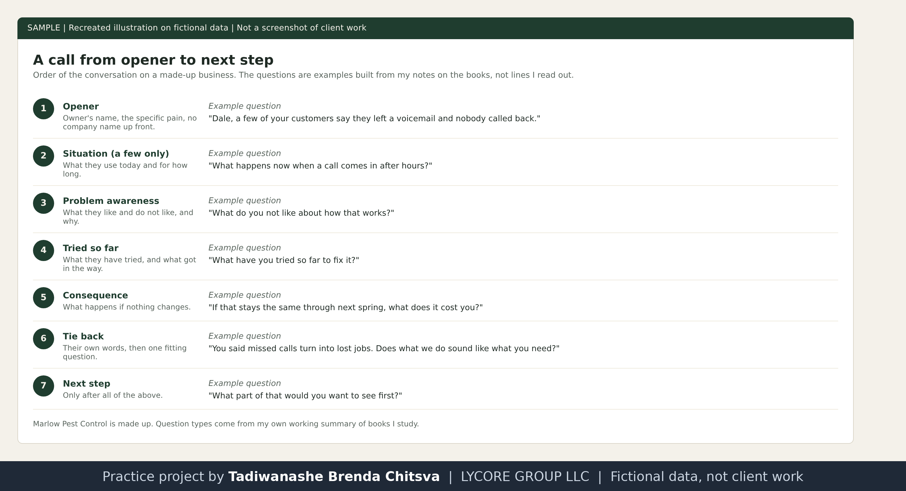

# Discovery and product pivots

Method page on a made-up business. Marlow Pest Control is invented. The question lists are my own working summary of ideas from books I study, and the call flow is mine. This is not a results report. See [why these projects use made-up data](../CONFIDENTIALITY.md).

## How I listen
In discovery I listen for what the owner is complaining about. If they are not interested, I try to find out why: is it because they are already tired of cold calls? That is a very different problem from a business that does not need what I offer, and it gets a different response. I do not push past it. I ask what they are doing about the issues I found.

## Question types I work from
These come from the NEPQ Black Book of Questions and The Sales Game, in my own words:
- **Situation:** what they use today and how long. A few of these only. They are context, not the point.
- **Problem awareness:** what they like and do not like about it, and why.
- **Tried so far:** what they have already tried, and what got in the way.
- **Consequence:** what happens if nothing changes for a year or two.
- **Importance:** how much it matters to fix it now.
- **Tie back:** I repeat their own words and ask whether what we do sounds like what they need.
- **Next step:** only after all of the above.

The Sales Game adds a short version of the same idea, four questions: what are you doing now, where do you want to go, why have you not got there yet, and would you like help. The Complete Sales Workbook calls this the doctor method: diagnose before you prescribe.

## Example on a made-up business

Recreated illustration. Marlow Pest Control is made up.

Using the research card from [research before the call](sales-02-research-before-the-call.md), the questions in order would be about: what happens to a voicemail left after hours, how many calls they think are going unanswered in a week, what they have tried about it, and what a missed call is worth to them in a season. Each one is a plain question about something real, and each answer sets up the next.

## Pivoting between products
The businesses I call usually have more than one problem, and we offer more than one product. If I notice a different problem while we talk, I say something like: I can see this may not be the product for you, but we do offer another one that fits what you just told me. I then offer that one.

Why it works for the person on the call:
- They can say no to the first product without feeling turned down.
- It shows that I was listening to them, not to my script.
- It keeps the conversation on their problem, so one no does not end the call.

The condition: the second problem has to be real and come from their own words. I do not invent a second need to keep the call going.

## Honest level
This is my method and my practice. I have no results to publish, and I do not claim any.
