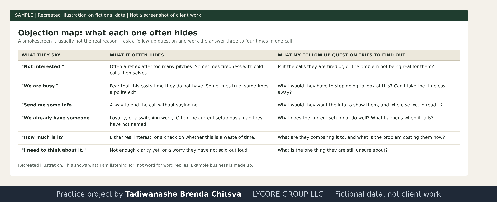
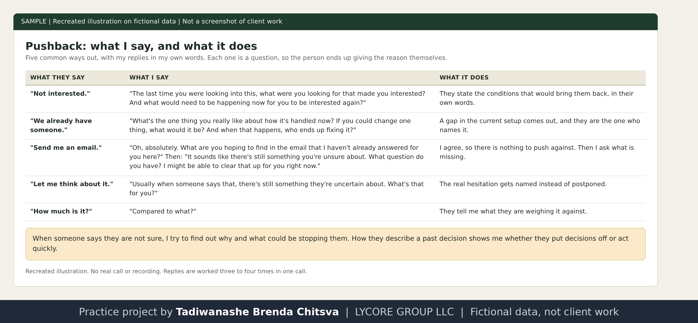

# Objections: what they hide and how I work them

Method page. The books named here are books I study, and the summaries are in my own words. The business examples are made up. This is not a results report. See [why these projects use made-up data](../CONFIDENTIALITY.md).

## How I treat an objection
An objection is a smokescreen. The person usually does have the problem underneath it, so the first thing they say is rarely the real reason. I do not argue with the first objection. I ask a follow up question that opens it, so the owner ends up saying the real reason in their own words, and then I work that one.

I work each objection three to four times in one call. The first answer to a question is often a polite exit, so one try is not enough, and giving up after one try means I never reached the real reason.

## What I do not do
- I never offer "a better time" and I do not ask if I caught them at a bad time. Both hand the person a polite way to leave, and the next call starts colder than this one.
- I do not accept a first no from a gatekeeper.
- I do not sound too nice or neutral. A flat, apologetic voice sounds like someone who does not expect to be useful.
- I do not explain myself at length before I have asked a question.

## What the common ones usually hide

Recreated illustration. Example business is made up.

The right hand column is what my follow up question is trying to find out. My replies in my own words are in the next section.

## What I say, in my own words

Recreated illustration. No real call or recording.

- **"Not interested."** "The last time you were looking into this, what were you looking for that made you interested? And what would need to be happening now for you to be interested again?"
- **"We already have someone."** "What's the one thing you really like about how it's handled now? If you could change one thing, what would it be? And when that happens, who ends up fixing it?"
- **"Send me an email."** "Oh, absolutely. What are you hoping to find in the email that I haven't already answered for you here?" Then: "It sounds like there's still something you're unsure about. What question do you have? I might be able to clear that up for you right now."
- **"Let me think about it."** "Usually when someone says that, there's still something they're uncertain about. What's that for you?"
- **"How much is it?"** "Compared to what?"

Each reply is a question, so the person ends up giving the reason themselves. I work each one three to four times in the same call.

## When someone is not sure
When someone says they are not sure, I try to find out why and what could be stopping them. How they describe a past decision also tells me something: whether they tend to put decisions off or act quickly.

## What I learn from the calls
I try to learn from every call. If you call 50 to 100 people, you quickly find out what the common objections are in that industry, what the businesses are looking for, and whether they share a problem. I write down the objections that keep coming up and use them to improve the script.

## Ideas from the books (my summary)
- **The Sales Game:** the first objection is often fear or missing information, and a short, curious "what else" can move a person from a surface reason to the real one. It also says to prepare for the same ten to twenty objections again and again, because they repeat.
- **The Complete Sales Workbook:** an objection is a request for more information, not a rejection. It also separates price from cost: price is what is paid once, cost is what a problem keeps charging.
- **NEPQ Black Book:** when a person raises a concern, ask questions that let them find their own answer, instead of answering for them.

## Why a follow up question works on the person
- A statement from me invites an argument. A question from me asks for their reasoning, so they have to look at it themselves.
- When they say the real reason out loud, they hear it, and it is theirs. They believe what they say far more than what I tell them.
- It keeps the call a conversation. A direct rebuttal to the first objection starts a debate, and the owner defends their position instead of looking at it.

## Honest level
I know these objections and how I work them. I have no win rate or conversion figure to publish.
