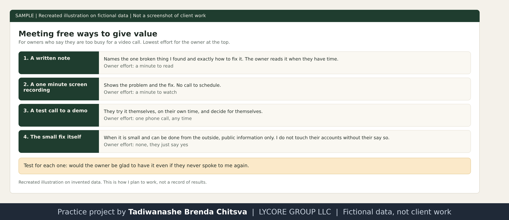

# Value first, for owners too busy for a meeting

Method page. The example is made up. This is not a results report. See [why these projects use made-up data](../CONFIDENTIALITY.md).

## The rule
Value first, payment later. Many owners are too busy for a video call, so instead of pushing for one I offer to fix something for free. People have been burned many times by small agencies and consultants selling automation and voice agents, and they are skeptical. I have to get past three things in order: the annoyance of being a cold caller, the annoyance of disturbing them at work, and then the annoyance of asking for money before I have given anything.

So the risk has to be low on the client side. If they have nothing to lose, it is hard to say no.

## Ways to give value without a meeting
These are formats I plan around, so the owner never has to find a calendar slot:
- a short written note naming the one broken thing I found and exactly how to fix it
- a screen recording of about a minute, showing the problem and the fix
- a test call to a demo they can try themselves, on their own time
- the fix itself, when it is small and I can do it from the outside

Recreated illustration on invented data.

## Boundaries
- The free piece is small and real. It is one thing that is broken, not a free project.
- I only work from public information. I do not touch an owner's accounts or settings without their say so.
- I do not hold a free fix over their head. If they never reply, I stop.

## Why this works on the person
- The first move comes from me, so the risk that normally sits with the owner sits with me.
- It answers the question they are really asking under "I am too busy": what will this cost me in time and trust.
- Owners who have been let down before are not looking for a promise. A small piece of finished work is something they can check themselves.

## Where it can go wrong
If the free piece is vague, or tries to hide a sales pitch, it adds to the annoyance instead of removing it. The test I use: would the owner be glad to have it even if they never spoke to me again.

## Honest level
This is how I plan to work when owners say they are too busy. I do not publish examples from real businesses.
