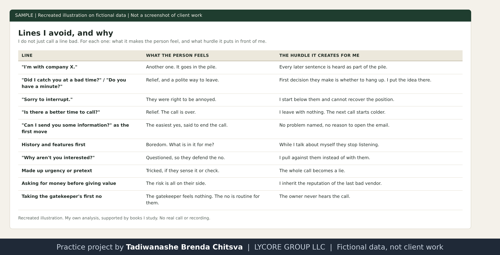

# Lines I avoid, and why

Method page. I do not just call a line bad. For each one I write what it makes the person feel, and what hurdle it puts in front of me. The reasons are my own analysis, supported by books I study. This is not a results report. See [why these projects use made-up data](../CONFIDENTIALITY.md).

Recreated illustration. No real call or recording.

## The lines, one by one

**"I'm with company X."** The owner hears the same opener many times a month. The company name tells them which pile this call goes in. They feel: another one. The hurdle: every sentence after it is heard as part of that pile.

**"Did I catch you at a bad time?" and "Do you have a minute?"** These ask for permission to leave. They feel: relief, and an easy way out that sounds polite. The hurdle: the first decision they make is whether to hang up, and I put the idea in their head. It also tells them I think I am an interruption.

**"I'm sorry to interrupt."** An apology at the start lowers me and raises their annoyance, because I have just agreed that they were right to be annoyed.

**"Is there a better time to call?"** They agree because it ends the call. They feel: relief. I leave with nothing, and the next call starts colder.

**"Can I send you some information?" as the first move.** It is the easiest yes in the world, said to end the call. They feel: the conversation is over. I have no problem named and no reason for them to open the email.

**Company history and features first.** They feel: nothing, or boredom. They want to know what is in it for them, so while I talk about myself they stop listening.

**"Why aren't you interested?"** It feels like an interrogation. They defend the no, and I am pulling against them. I ask something gentler about what is behind it, for example whether it is the calls themselves they are tired of.

**Making up urgency or a pretext.** Some scripts invent a product recall or a message from an assistant. If the owner senses it or checks it, they feel tricked and the whole call becomes a lie. I only use real findings, which is also why I research first.

**Asking for money before giving value.** They have been burned before by small agencies. They feel: the risk is all on their side. The hurdle: I inherit the reputation of the last bad vendor.

**"What's holding you back?" and "Do you think it would work?" at the close.** They push the person into defending themselves or doubting. They feel questioned and move back to a safe no. I use a question about what part fits them best, so they argue for it.

**Taking the receptionist's first no.** A gatekeeper's no is routine and does not come from the owner. Accepting it means the owner never hears the call.

## Where these ideas come from
- The Sales Game (Daniel G): why apologies, "do you have a minute" and weak close questions backfire, and how to think about buyer states.
- The Complete Sales Workbook (Shelby Sapp): objections as requests for information, and the doctor method of diagnosing before prescribing.
- The NEPQ Black Book of Questions: how questions let a person persuade themselves.
- The 7 Figure Sales Script (Sheila Bella): the order of rapport, framing, discovery and pitch. It is written for beauty businesses, so I only use its structure.

I study these books for the thinking behind them. I do not copy their text here, and I add my own research and wording to anything I use.
