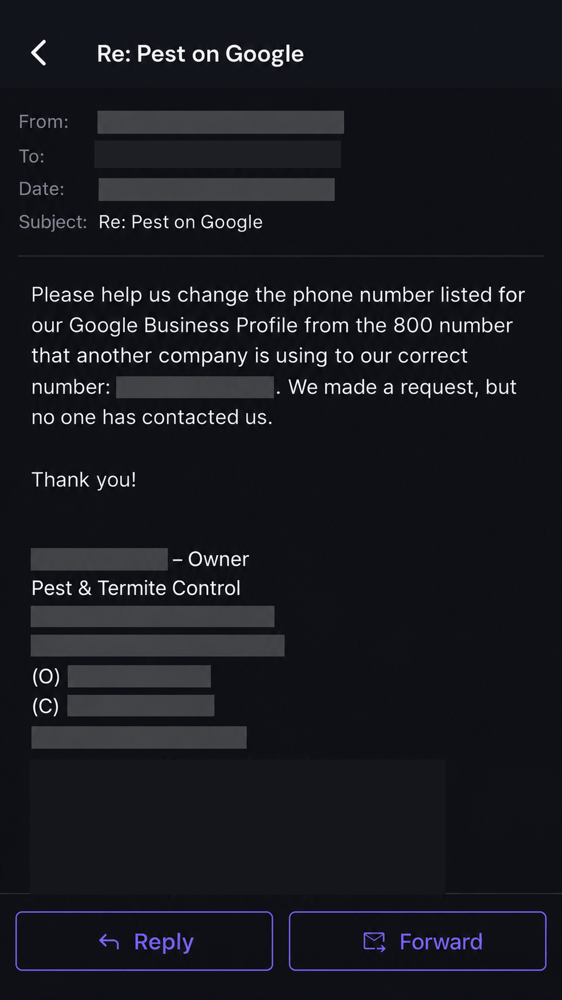

# Service-Business Websites and Lead-Capture Workflows

**Type:** website design and implementation samples for U.S. service businesses, plus Google Business Profile and reputation support.
**Status:** sites built on Next.js and deployed to Vercel for my own properties and prototypes; client builds described only where verified.

## Business problem

A visitor needs to identify a service, trust the business and contact someone fast. A site that looks polished but hides the phone number, makes the form difficult or routes enquiries nowhere does not produce calls. Many local businesses also have Google Business Profile problems (wrong phone number, unanswered reviews, duplicate listings) that cost them calls before the website is even visited.

## What I built

- Responsive layouts for desktop and mobile with service-specific calls to action and click-to-call on every page.
- Home, service, service-area and contact-page structures for home-service businesses.
- Lead forms and appointment-request paths that post to a webhook, so the submission can reach a CRM or notification workflow.
- Website content audits for confusing navigation, weak calls to action, inaccurate business information and friction in enquiry flows.
- Google Business Profile audits and support requests, including correcting listing details and review-response processes.
- Readability, load-performance and basic accessibility checks.

## Stack

Next.js, Vercel, Supabase for form storage where needed, GSAP for motion, n8n for form-to-CRM routing.

## Representative project concepts

- **Towing and roadside assistance website designs:** urgent call-to-action hierarchy, emergency enquiries, location and service coverage, mobile usability.
- **Pest control and home-service lead-capture websites:** lead forms, callback requests, qualification fields and integration-ready submission flows.
- **Conversion-oriented website and Google Business Profile reviews:** audits to identify friction before proposing changes.

These are design and project samples. This page does not claim measured conversion lifts, published client contracts or a live implementation where none is verified.

## Evidence

*Recreated and anonymized illustration.* After an outreach campaign offering Google Business Profile assistance, a pest and termite control owner replied asking for help changing the phone number shown on their listing, which displayed another company's number. Name, business name, contact details, address, date and award badges have been removed. This illustrates the kind of listing problem local businesses ask for help with; it does not establish that the issue was resolved or that a paid engagement followed.

## Typical acceptance checklist

1. Important pages work on a small mobile screen.
2. Click-to-call and form submission controls work as expected.
3. Service area, service type, hours and next steps are easy to find.
4. Enquiry submissions reach the intended destination.
5. Consent fields and privacy disclosures are appropriate for the intended use.
6. Form failure, duplicate submissions and unsupported user input are handled.

## Implemented versus possible

| Implemented and tested | Possible with client access |
|---|---|
| Next.js site builds deployed to Vercel | Client domain, DNS and hosting migration |
| Form-to-webhook submission flows | Form-to-GoHighLevel or HubSpot contact creation under the client's account |
| Google Business Profile audit process | Listing corrections that require owner verification |

**Portfolio materials available on request:** screenshots of non-client prototypes and a publicly shareable sample that does not expose restricted contact details.
