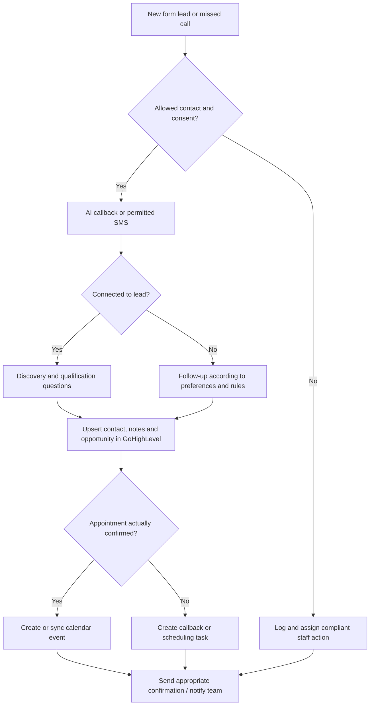

# GoHighLevel Speed-to-Lead, Voice AI & SMS Automation

## What speed to lead means

Speed to lead measures the time between a lead expressing interest and the business responding. For example, a person submits a form and an automation begins a permitted AI callback or SMS response. **An initial contact within 30 seconds is the design target, not a measured guarantee.**

## Example workflow

1. Form submitted or missed call captured.
2. Record source, consent, operating hours and lead identity.
3. Check existing contacts, appointments and opt-out status.
4. Trigger the permitted route: AI callback, SMS or staff notification.
5. Ask discovery questions: service, location, urgency, timeframe and desired next step.
6. Write relevant fields, notes, tags and opportunities to **GoHighLevel**, avoiding duplicates.
7. Check scheduling where integrated; confirm actual bookings or create a callback task.
8. Send allowed confirmation/reminders and notify the appropriate team member.
9. Record timestamps, errors, retries and handoff outcomes.

## Technologies

- **GoHighLevel:** CRM contacts, opportunities, pipeline stages, custom fields, booking and follow-up workflows.
- **n8n / APIs / webhooks:** event mapping, conditional logic, deduplication and notifications.
- **Voice:** Retell AI and other compatible conversation agents.
- **Calendars:** Cal.com, Calendly and Google Calendar where supported.
- **Other potential connections:** HubSpot, Jotform, Notion, Slack, Jobber and other tools subject to access and tested integration.

## A2P 10DLC and permission controls

U.S. business texting on 10-digit long-code numbers can require A2P 10DLC brand and campaign registration, appropriate use-case registration, documented consent and functioning opt-out handling. Registration does not replace consent. Check any applicable calling and messaging rules before activating automated outreach.

## Acceptance checks

- Lead arrives in the correct pipeline with source and qualification data.
- Form-to-response latency is **measured**, not assumed.
- Non-consenting or opted-out leads are excluded from disallowed messages.
- No unintended duplicate contacts or calendar bookings.
- Missed transfers, staff unavailability, failed messages, rate limits and API/webhook errors have fallbacks.
- A booking link is not represented as an actual confirmed booking.
- The business can see the lead's next action and supporting notes.

**Scope note:** this page documents a workflow design and testing criteria. It does not claim that every named connector is deployed.

## Illustrative integration architecture

This is a reference workflow specification. Actual API availability, messaging permission, response time and end-to-end success require project-specific testing.
