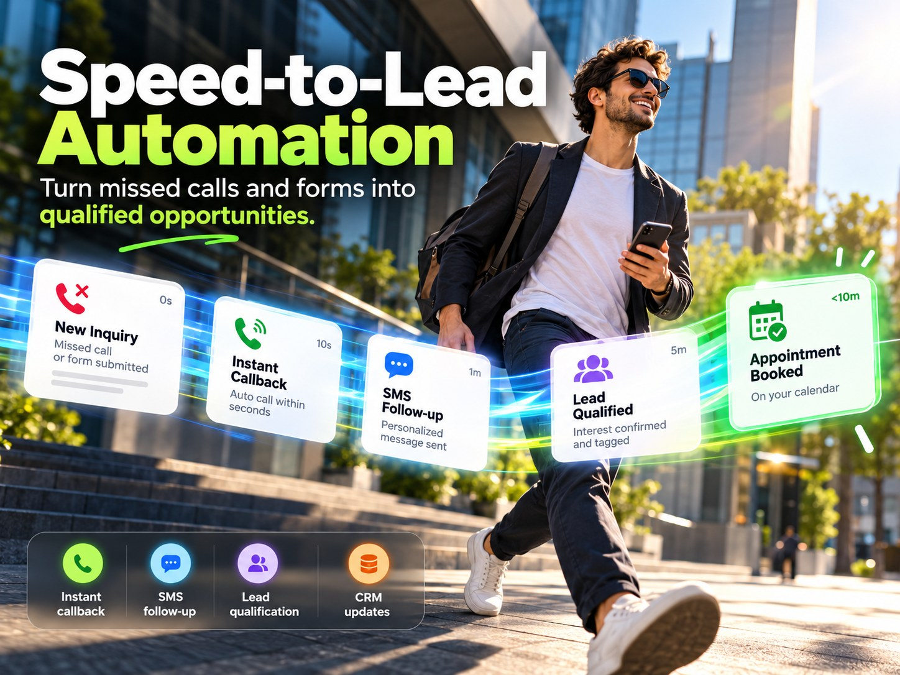
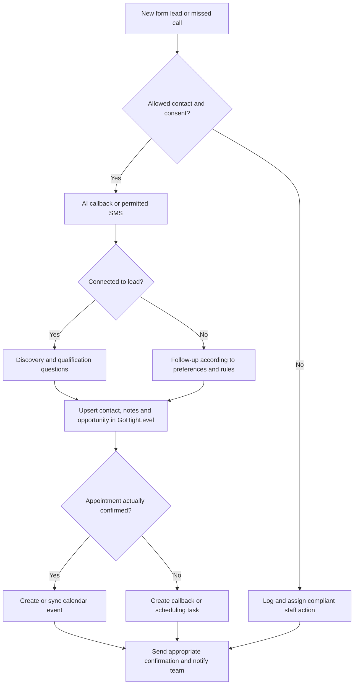

# GoHighLevel Speed-to-Lead, Voice AI and SMS Automation

**Type:** workflow design and acceptance criteria for responding to new leads automatically.
**Status:** workflow logic and GoHighLevel configuration patterns built and tested in my own accounts; not described as deployed for a paying client.

## Service overview

*Concept graphic with fictional sample data. The timings on the graphic are design targets, not measured results. It is not a client result, screenshot or measured outcome.*

## Business problem

Speed to lead measures the time between a lead expressing interest and the business responding. Most service businesses respond in hours, by which time the prospect has called a competitor. **An initial contact within 30 seconds is the design target, not a measured guarantee.**

## What I built

- GoHighLevel pipelines, custom fields, tags and opportunity stages for inbound leads.
- Trigger logic for form submissions and missed calls.
- n8n workflows that check consent and existing contacts, then route to an AI callback, a permitted SMS or a staff notification.
- Discovery-question design for the voice agent: service, location, urgency, timeframe and desired next step.
- CRM write rules that avoid duplicate contacts and record the outcome, timestamps and errors.
- A2P 10DLC brand and campaign registration completed for my own sending number, with consent language and STOP handling.

## Example workflow

1. Form submitted or missed call captured.
2. Record source, consent, operating hours and lead identity.
3. Check existing contacts, appointments and opt-out status.
4. Trigger the permitted route: AI callback, SMS or staff notification.
5. Ask discovery questions: service, location, urgency, timeframe and desired next step.
6. Write relevant fields, notes, tags and opportunities to **GoHighLevel**, avoiding duplicates.
7. Check scheduling where integrated; confirm actual bookings or create a callback task.
8. Send allowed confirmation or reminders and notify the appropriate team member.
9. Record timestamps, errors, retries and handoff outcomes.

## Technologies

- **GoHighLevel:** CRM contacts, opportunities, pipeline stages, custom fields, booking and follow-up workflows.
- **n8n, APIs and webhooks:** event mapping, conditional logic, deduplication and notifications.
- **Voice:** Retell AI and Bland AI.
- **Telephony and SMS:** Twilio or GoHighLevel's native LC Phone, subject to the client's setup.
- **Calendars:** Cal.com, Calendly and Google Calendar where supported.
- **Other possible connections:** HubSpot, Jotform, Notion, Slack, Jobber and other tools subject to access and tested integration.

## A2P 10DLC and permission controls

U.S. business texting on 10-digit long-code numbers requires A2P 10DLC brand and campaign registration, appropriate use-case registration, documented consent and functioning opt-out handling. Registration does not replace consent. Check applicable calling and messaging rules before activating automated outreach.

## Acceptance checks

- Lead arrives in the correct pipeline with source and qualification data.
- Form-to-response latency is **measured**, not assumed.
- Non-consenting or opted-out leads are excluded from disallowed messages.
- No unintended duplicate contacts or calendar bookings.
- Missed transfers, staff unavailability, failed messages, rate limits and API or webhook errors have fallbacks.
- A booking link is not represented as a confirmed booking.
- The business can see the lead's next action and supporting notes.

## Illustrative integration architecture

This is a reference workflow specification. Actual API availability, messaging permission, response time and end-to-end success require project-specific testing.

## Implemented versus possible

| Implemented and tested | Possible with client access |
|---|---|
| GoHighLevel pipeline, fields, tags, workflow triggers | Client-specific calendar sync and double-booking rules |
| n8n routing, dedup and CRM upsert logic | Two-way SMS conversations under the client's A2P registration |
| Own-number A2P 10DLC registration and STOP handling | Integration with Jobber, Housecall Pro or ServiceTitan |
